# Сортировка выбором

Степанов Николай Викторович 151319

Code and Cold Club 2026

???
Добрый день. Сегодня мы разберём второй алгоритм из книги Адитьи Бхаргавы «Грокаем алгоритмы» — сортировку выбором. Но прежде чем дойти до неё, нам придётся разобраться с двумя структурами данных, без которых этот алгоритм не имеет смысла: массивами и связанными списками. Глава так и построена: сначала память, потом структуры, потом алгоритм.

---

## Оглавление

!toc

???
Структура презентации повторяет структуру главы: от того, как устроена память, через массивы и связанные списки, к их сравнению, затем к самой сортировке выбором, коду и итогам. В конце — шпаргалка.

---

# Память компьютера и способы хранения данных

---

## Как работает память

Представьте, что вы пришли в театр и хотите оставить свои личные вещи в гардеробе. Для хранения вещей есть специальные ящики.

В каждом ящике помещается один предмет. Вы хотите сдать на хранение две вещи, поэтому требуете выделить вам два ящика.


???
Представьте, что вы пришли в театр и хотите оставить вещи в гардеробе. Для хранения есть специальные ящики, и в каждом помещается один предмет. Вы хотите сдать две вещи — вам выделяют два ящика. Готово, можно идти на спектакль.

Именно так работает память компьютера. Это огромный шкаф со множеством ящиков, и у каждого ящика есть адрес. Когда вы хотите сохранить отдельное значение, вы запрашиваете у компьютера место, а он выдаёт адрес.

**Что здесь важно и чего нет на слайде:** адрес — это не «номер ящика» в бытовом смысле, а именно адрес ячейки памяти, как `fe0ffeeb` в книге. Компьютер не «знает», что лежит в ячейке; он просто знает, где она. Всё остальное — дело программы.

---

## Адрес ячейки памяти

В сущности, именно так работает память вашего компьютера. Она представляет собой нечто вроде огромного шкафа со множеством ящиков, и у каждого ящика есть адрес.

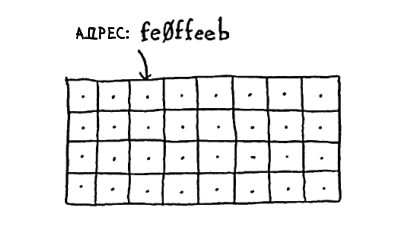

???
Вы сдали две вещи, получили два ящика. Компьютер устроен так же: у каждого ящика есть адрес.

**Чего нет на слайде:** в книге на этой же странице показан пример адреса `fe0ffeeb` — шестнадцатеричная строка, которая выглядит как случайный набор символов. Это важно проговорить: адрес — абстракция, а не «место в шкафу», которое можно потрогать. Для нас важно только то, что по адресу можно мгновенно обратиться к значению.

---

## Массивы и связанные списки

Каждый раз, когда вы хотите сохранить в памяти отдельное значение, вы запрашиваете у компьютера место в памяти, а он выдает адрес для сохранения значения.

Если же вам понадобится сохранить несколько элементов, это можно сделать двумя основными способами: воспользоваться массивом или списком.

Не существует единственно верного способа сохранения данных на все случаи жизни, поэтому вы должны знать, в чем отличие разных способов.

???
Каждый раз, когда вы хотите сохранить отдельное значение, вы запрашиваете у компьютера место, а он выдаёт адрес. Если нужно сохранить несколько элементов, есть два основных способа: массив или связанный список.

**Чего нет на слайде:** в книге дальше сказано прямо — «Не существует единственно верного способа сохранения данных на все случаи жизни, поэтому вы должны знать, в чем отличие разных способов». Это ключевая мысль всей главы: нет «плохой» и «хорошей» структуры, есть подходящая и неподходящая для задачи.

---

## Список задач

Иногда в памяти требуется сохранить список элементов. Предположим, вы пишете приложение для управления текущими делами. Описания задач должны храниться в виде списка в памяти.

Что использовать — массив или связанный список?


???
Предположим, вы пишете приложение для управления текущими делами. Описания задач должны храниться в виде списка в памяти. Что использовать — массив или связанный список? Для начала попробуем сохранить задачи в массиве, потому что этот способ более понятен.

---

# Массивы

---

## Непрерывное хранение

При использовании массива все задачи хранятся в памяти непрерывно (то есть рядом друг с другом).

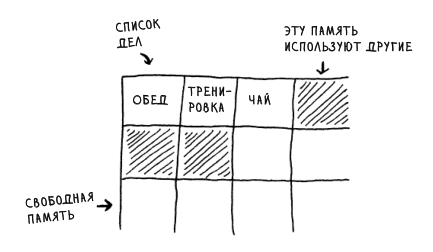

???
При использовании массива все задачи хранятся в памяти непрерывно, то есть рядом друг с другом. В книге это показано на примере списка задач: обед, тренировка, чай — три ячейки подряд.

**Чего нет на слайде:** в книге отдельно проговорено, что массив — «более понятный» способ, поэтому с него и начинают. Это не значит, что он лучше; это значит, что он проще для первого знакомства.

---

## Проблема добавления

Теперь предположим, что вы захотели добавить четвертую задачу. Но следующий ящик уже занят — там лежат чужие вещи!

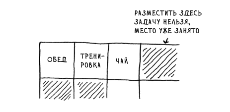

???
Вы захотели добавить четвёртую задачу. Но следующий ящик уже занят — там лежат чужие вещи. Придётся запросить у компьютера другой блок памяти, в котором поместятся все четыре задачи, и переместить все задачи туда.

**Чего нет на слайде:** в книге это объясняется через аналогию с кино. Вы пришли с друзьями, нашли места для своей компании, но тут приходит ещё один друг — и ему сесть некуда. Приходится искать новое место, где смогут разместиться все. Это ровно то, что происходит с массивом при добавлении элемента: старый блок памяти мал, нужен новый, и все данные надо перенести.

---

## Перемещение в новую область

Представьте, что вы пошли в кино с друзьями и нашли места для своей компании, но тут приходит еще один друг, и ему сесть уже некуда. Приходится искать новое место, где смогут разместиться все.

В нашем случае вам придется запросить у компьютера другой блок памяти, в котором поместятся все четыре задачи, а потом переместить все свои задачи туда.

???
Представьте, что вы пошли в кино с друзьями и нашли места для своей компании, но тут приходит ещё один друг, и ему сесть уже некуда. Приходится искать новое место, где смогут разместиться все.

В нашем случае вам придётся запросить у компьютера другой блок памяти, в котором поместятся все четыре задачи, а потом переместить все свои задачи туда.

---

## Бронирование места

Если вдруг придет еще один друг, места опять не хватит и вам придется перемещаться снова! Сплошная суета. Кроме того, добавление новых элементов в массив станет серьезной проблемой.

Простейшее решение — «бронирование мест»: даже если список состоит всего из 3 задач, вы запрашиваете у компьютера места на 10 позиций... просто на всякий случай.

- Лишнее место может не понадобиться, и тогда память будет расходоваться неэффективно.
- Если в список будет добавлено более 10 задач, перемещать все равно придется.

В общем, прием неплохой, но его нельзя назвать идеальным.

???
Если вдруг придёт ещё один друг, места опять не хватит и вам придётся перемещаться снова! Сплошная суета. Кроме того, добавление новых элементов в массив станет серьёзной проблемой.

Простейшее решение — «бронирование мест»: даже если список состоит из трёх задач, вы запрашиваете место на десять позиций, просто на всякий случай. Тогда можно добавить до десяти задач и ничего перемещать не придётся.

**Чего нет на слайде:** в книге прямо сказано — «Это неплохое обходное решение, но у него есть пара недостатков». То есть это не решение проблемы, а её отсрочка. Первый недостаток: лишнее место может не понадобиться, и тогда память расходуется неэффективно. Вы её не используете, но и никто другой не может её использовать. Второй: если в список будет добавлено больше десяти задач, перемещать всё равно придётся.

---

# Связанные списки

---

## Произвольное размещение

При использовании связанного списка элементы могут размещаться где угодно в памяти.

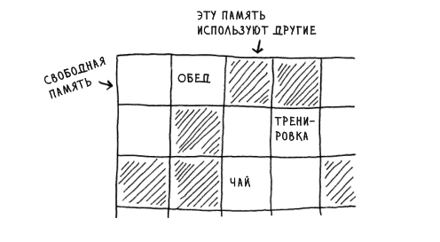

???
При использовании связанного списка элементы могут размещаться где угодно в памяти. В каждом элементе хранится адрес следующего элемента. Набор произвольных адресов объединяется в цепочку.

**Чего нет на слайде:** в книге это сравнивается с игрой «Найди клад». Вы приходите по первому адресу, там написано: «Следующий элемент находится по адресу 123». Вы идёте по адресу 123, там написано: «Следующий элемент находится по адресу 847» — и так далее. Это и есть суть связанного списка: не непрерывность, а цепочка адресов.

---

## Указатели

В каждом элементе хранится адрес следующего элемента списка. Таким образом, набор произвольных адресов памяти объединяется в цепочку.

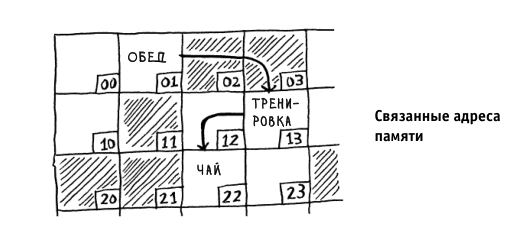

???
В каждом элементе связанного списка выделяется некоторый объём памяти для хранения адреса следующего элемента. Эта часть элемента называется указателем.

**Чего нет на слайде:** в книге это вынесено в отдельную врезку и сказано: «Периодически вы будете встречать этот термин, особенно если вы пишете на низкоуровневом языке, таком как C. Поэтому полезно знать, что он означает». То есть указатель — это не «магическая стрелочка», а конкретная часть элемента, в которой лежит адрес. В C это буквально переменная-адрес; в Python указатели скрыты, но концепция та же.

---

## Как в игре «Найди клад»

Все как в игре «Найди клад». Вы приходите по первому адресу, там написано: «Следующий элемент находится по адресу 123». Вы идете по адресу 123, там написано: «Следующий элемент находится по адресу 847» и т. д.

Добавить новый элемент в связанный список проще простого: просто разместите его по любому адресу памяти и сохраните этот адрес в предыдущем элементе.

???
Все как в игре «Найди клад». Добавить новый элемент в связанный список проще простого: разместите его по любому адресу памяти и сохраните этот адрес в предыдущем элементе.

**Чего нет на слайде:** в книге отдельно подчёркнуто, что со связанными списками ничего перемещать в памяти не нужно. Это их главное преимущество перед массивами при вставке. Но у этого преимущества есть цена — и она проявится в теме сравнения.

---

## Вставка в середину списка

Предположим, вы решили, что список задач должен больше напоминать календарь. Прежде данные добавлялись только в конец списка, а теперь они должны добавляться в порядке их выполнения.


???
Представьте, что список задач должен больше напоминать календарь: данные добавляются не в конец, а в порядке выполнения. В книге показаны две картинки — неупорядоченный список и упорядоченный. Разница между ними — это и есть разница между «просто списком» и «списком, в который вставляют в середину».

---

## Список решает задачу

Со списком задача решается изменением указателя в предыдущем элементе.

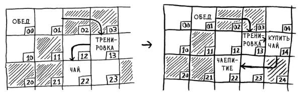

???
Со списком задача решается изменением указателя в предыдущем элементе. Достаточно поменять одну стрелочку — и новый элемент уже в цепочке.

---

## Массив требует сдвига

А при работе с массивом придется сдвигать все остальные элементы.

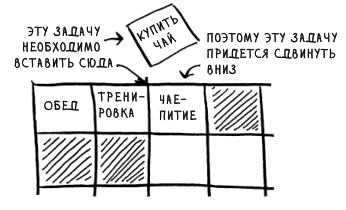

А если свободного места не осталось, все данные придется скопировать в новую область памяти! В общем, списки лучше подходят для вставки элементов в середину.

???
А при работе с массивом придётся сдвигать все остальные элементы. Если вставляете в начало — сдвигается весь массив. А если свободного места не осталось, все данные придётся скопировать в новую область памяти.

В общем, списки лучше подходят для вставки элементов в середину. Это и есть их главное преимущество.

---

# Сравнение массивов и связанных списков: доступ, кэширование и память

---

## Произвольный и последовательный доступ

Всего существуют два вида доступа: произвольный и последовательный. При последовательном доступе элементы читаются по одному, начиная с первого.

Связанные списки поддерживают только последовательный доступ. Чтобы прочитать 10-й элемент связанного списка, вам придется прочитать первые 9 элементов и перейти по ссылкам к 10-му элементу.

???
Всего есть два вида доступа: произвольный и последовательный. При последовательном элементы читаются по одному, начиная с первого. Связанные списки поддерживают только последовательный доступ.

**Чего нет на слайде, но есть в книге:** пример с хит-парадами. Сайты со «злодейскими десятками» заставляют нажимать Next девять раз, чтобы добраться до первого места. Это и есть последовательный доступ: чтобы прочитать десятый элемент связанного списка, придётся прочитать первые девять и перейти по ссылкам к десятому.

---

## Массивы и произвольный доступ

Работая с массивом, вы заранее знаете адрес каждого его элемента. Допустим, массив содержит пять элементов и вы знаете, что он начинается с адреса 00. По какому адресу хранится пятый элемент?

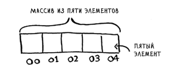

Простейшая математика дает ответ: это адрес 04. Массивы прекрасно подходят для чтения элементов в произвольных позициях, потому что обращение к любому элементу в массиве происходит мгновенно.

???
Работая с массивом, вы заранее знаете адрес каждого элемента. Массив начинается с адреса 00, пятый элемент — по адресу 04. Простейшая математика. Массивы прекрасно подходят для чтения в произвольных позициях, потому что обращение к любому элементу происходит мгновенно.

**Чего нет на слайде:** в связанном списке мгновенно определить позицию i-го элемента невозможно — нужно обратиться к первому, получить адрес второго, затем ко второму — и так далее, пока не доберётесь до i-го.

---

## Кэширование

Даже безотносительно произвольного доступа массивы работают быстрее, поскольку могут использовать кэширование.

Компьютеры читают целыми разделами, поскольку это значительно ускоряет переход к следующему элементу.

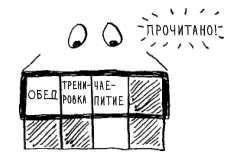

С массивами можно прочитать целый раздел элементов. В связанном списке местоположение следующего элемента неизвестно. Придется прочитать элемент, узнать, где находится следующий, а затем прочитать и его.

???
Даже безотносительно произвольного доступа массивы работают быстрее, потому что могут использовать кэширование. Компьютеры читают целыми разделами, а не по одному элементу. С массивом можно прочитать целый раздел; в связанном списке местоположение следующего элемента неизвестно — придётся прочитать элемент, узнать, где следующий, и прочитать его.

**Чего нет на слайде, но есть в книге:** вывод — «Таким образом, массивы обеспечивают не только произвольный, но и более быстрый последовательный доступ!». Это неочевидно: даже если вам нужно прочитать весь список подряд, массив всё равно быстрее — из-за кэша.

---

## Расход памяти

Помните, я говорил, что в случае с массивами обычно выделяют больше памяти, чем нужно, и если в конечном итоге она не задействуется, то ее ресурс расходуется впустую?

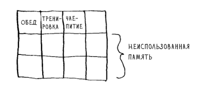

|||

На самом деле объем такой неиспользованной памяти получается не очень большим. С другой стороны, когда вы применяете связанный список, вы выделяете дополнительную память для каждого элемента, поскольку в ней сохраняется адрес следующего элемента.

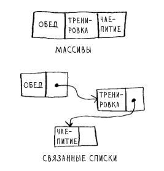

???
Про память: массив обычно выделяет больше, чем нужно, и если память не задействуется, она расходуется впустую. Но объём такой неиспользованной памяти не очень большой. С другой стороны, связанный список выделяет дополнительную память для каждого элемента — там хранится адрес следующего. Поэтому связанные списки занимают больше места, если их элементы относительно невелики.

**Чего нет на слайде, но есть в книге:** важная оговорка — «если элементы массива крупные, то даже один слот неиспользованной памяти может оказаться очень большим, а объём дополнительной памяти, используемой для хранения указателей, по сравнению с ним будет незначительным». То есть вывод «списки занимают больше» верен не всегда — зависит от размера элементов.

---

## Сводная таблица сложностей

|  | Массивы | Списки |
|---|---|---|
| **Чтение** | O(1) | O(n) |
| **Вставка** | O(n) | O(1) |
| **Удаление** | O(n) | O(1) |

O(n) = линейное время

O(1) = постоянное время

???
Таблица сложностей: чтение в массиве — O(1), в списке — O(n); вставка в массив — O(n), в список — O(1); удаление из массива — O(n), из списка — O(1).

**Чего нет на слайде, но есть в книге:** важная оговорка. Вставка и удаление выполняются за O(1) только в том случае, если вы можете мгновенно получить доступ к удаляемому элементу. На практике обычно сохраняются ссылки на первый и последний элементы связанного списка, поэтому время удаления этих элементов составит всего O(1). Для элемента в середине списка сначала придётся до него дойти — а это уже O(n).

---

## Что используется чаще?

Массивы используются чаще, поскольку имеют множество преимуществ перед связанными списками. Во-первых, их проще читать. Во-вторых, массивы поддерживают произвольный доступ.

Таким образом, массивы используются чаще, чем связанные списки, за исключением особых случаев.

???
Массивы используются чаще, потому что их проще читать и они поддерживают произвольный доступ. Таким образом, массивы используются чаще, чем связанные списки, за исключением особых случаев.

**Чего нет на слайде, но есть в книге:** «особые случаи» — это как раз частые вставки и удаления в середину. Если ваша задача — много вставлять и удалять, связанный список выигрывает. Если много читать — выигрывает массив. Это и есть практический вывод главы.

---

# Сортировка выбором

---

## Постановка задачи

А теперь объединим все, что вы узнали, во втором алгоритме: сортировке выбором. Чтобы освоить этот алгоритм, вы должны понимать, как работают массивы и списки и «О-большое».

Допустим, у вас на компьютере записана музыка и для каждого исполнителя хранится счетчик воспроизведений.

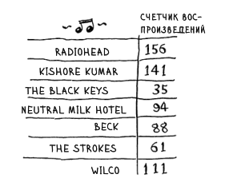

???
А теперь — сортировка выбором. Допустим, у вас на компьютере записана музыка и для каждого исполнителя хранится счётчик воспроизведений. Вы хотите отсортировать список по убыванию счётчика, чтобы любимые исполнители стояли на первых местах.

**Чего нет на слайде, но есть в книге:** чтобы освоить этот алгоритм, нужно понимать две вещи — как работают массивы и списки и что такое «О-большое». Первую мы только что разобрали; второе предполагается известным из главы 1.

---

## Идея сортировки выбором

Вы хотите отсортировать список по убыванию счетчика воспроизведений, чтобы самые любимые исполнители стояли на первых местах.

Одно из возможных решений — пройти по списку и найти исполнителя с наибольшим количеством воспроизведений. Этот исполнитель добавляется в новый список.

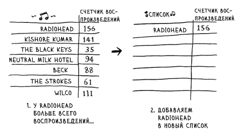

???
Одно из возможных решений — пройти по списку и найти исполнителя с наибольшим количеством воспроизведений. Этот исполнитель добавляется в новый список.

**Чего нет на слайде, но есть в книге:** в примере это Radiohead со 156 воспроизведениями. Дальше то же самое происходит со следующим по количеству — Kishore Kumar со 141. И так далее, пока список не будет отсортирован.

---

## Продолжение

Потом то же самое происходит со следующим по количеству воспроизведений исполнителем.

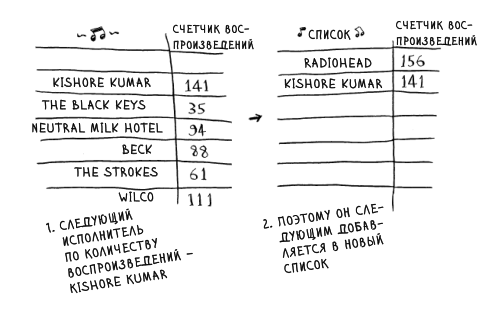

|||

Продолжая действовать так, мы получаем отсортированный список.

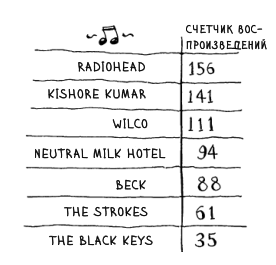

???
Потом то же самое происходит со следующим по количеству воспроизведений исполнителем. Продолжая действовать так, мы получаем отсортированный список.

**Чего нет на слайде, но есть в книге:** итоговый порядок в примере — Radiohead (156), Kishore Kumar (141), Wilco (111), Neutral Milk Hotel (94), Beck (88), The Strokes (61), The Black Keys (35). Это и есть сортировка выбором: на каждом шаге выбираем максимум из оставшихся.

---

## Оценка O(n²)

Чтобы найти исполнителя с наибольшим значением счетчика воспроизведения, необходимо проверить каждый элемент в списке. Это делается за время O(n).

Итак, имеется операция, выполняемая за время O(n), и ее необходимо выполнить n раз.

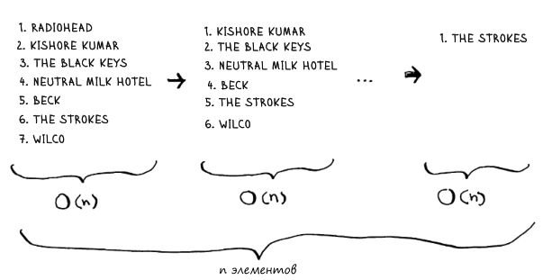

Все это требует времени O(n × n), или O(n²).

???
Чтобы найти исполнителя с наибольшим значением счётчика, нужно проверить каждый элемент списка. Это O(n). И такую операцию нужно выполнить n раз. Все это требует времени O(n × n), или O(n²).

**Чего нет на слайде, но есть в книге:** важно, что O(n) — это «по одному разу обратиться к каждому элементу». Простой поиск по списку исполнителей — ровно O(n): каждый исполнитель проверяется один раз.

---

## Уменьшение количества проверяемых элементов

При каждом выполнении операций количество элементов, которые нужно проверить, сокращается. Со временем все сведется к проверке всего одного элемента.

Почему же время выполнения все равно оценивается как O(n²)? Сначала проверяются n элементов, потом n – 1, n – 2 … 2, 1. В среднем проверяется список из ½ × n элементов. Однако константы (такие, как ½) в «О-большом» игнорируются, поэтому мы просто используем O(n × n), или O(n²).

???
При каждом выполнении операций количество элементов, которые нужно проверить, сокращается. В среднем проверяется список из ½ × n элементов. Время выполнения составит O(n × ½ × n). Однако константы, такие как ½, в «О-большом» игнорируются, поэтому мы используем O(n × n), или O(n²).

**Чего нет на слайде, но есть в книге:** это ответ на естественный вопрос — «почему O(n²), если мы каждый раз проверяем всё меньше элементов?». Ответ: потому что константы в «О-большом» отбрасываются. Подробно это разбирается в главе 4, но суть здесь: O(n²) — это оценка сверху, а не точное число операций.

---

## Перспектива быстрой сортировки

Алгоритм сортировки выбором легко объясняется, но медленно работает.

Быстрая сортировка — эффективный алгоритм сортировки, который выполняется за время O(n log n). Но мы займемся этой темой в следующий раз!

???
И последнее, чего нет на слайдах, но есть в книге: сортировка выбором легко объясняется, но медленно работает. Быстрая сортировка — эффективный алгоритм, который выполняется за O(n log n). Мы займёмся ей в следующий раз. Так что сортировка выбором — это не «финальный» алгоритм, а ступенька к быстрой сортировке.

---

# Пример кода и шпаргалка

---

## Поиск наименьшего элемента

```python
def findSmallest(arr):
    smallest = arr[0]  # Для хранения наименьшего значения
    smallest_index = 0 # Для хранения индекса наименьшего значения

    for i in range(1, len(arr)):
        if arr[i] < smallest:
            smallest = arr[i]
            smallest_index = i

    return smallest_index
```

???
Код: функция `findSmallest` находит индекс наименьшего элемента в массиве. Она проходит по массиву, начиная со второго элемента, сравнивает с текущим минимумом и запоминает индекс.

**Чего нет на слайде:** в книге код дан с комментариями «Для хранения наименьшего значения» и «Для хранения индекса наименьшего значения». Важно, что функция возвращает именно индекс, а не значение, — потому что дальше по индексу мы будем удалять элемент из массива.

---

## Сортировка выбором

```python
def selectionSort(arr):
    newArr = []

    for i in range(len(arr)):
        # Находит наименьший элемент в массиве и добавляет его в новый массив:
        smallest = findSmallest(arr) 
        newArr.append(arr.pop(smallest))

    return newArr

print(selectionSort([5, 3, 6, 2, 10])) # Сортирует массив
```

???
`selectionSort` создаёт новый массив, в цикле находит индекс наименьшего элемента в исходном массиве, извлекает его через `pop` и добавляет в новый массив. В конце возвращает новый массив.

**Чего нет на слайде, но есть в книге:** в книге пример вызова `print selectionSort([5, 3, 6, 2, 10])` — это Python 2. В новой версии исправлено на `print(selectionSort(...))`. Обратите внимание: алгоритм сортирует по возрастанию, хотя пример с музыкой был по убыванию — это разные задачи, и в книге они не смешиваются.

---

# Практикум

---

## Задание

1. Откройте папку `problems/L0` на рабочем столе.
2. Откройте `task.*.md` и прочитайте алгоритмическую задачу.
3. Запишите своё решение в файл `main.py`.
4. Проверьте решение:
    1. Откройте терминал `konsole`.
    2. Напишите `python `.
    3. Перетащите `test.py` в окно терминала; запустите.

Для помощи с синтаксисом python см. офф. документацию или следующий слайд.

???
Переходим к практике. Откройте папку `problems/L0` на рабочем столе, прочитайте задачу в `task.*.md`, запишите решение в `main.py`. Для проверки откройте терминал `konsole`, напишите `python`, перетащите `test.py` в окно терминала и запустите.

---

## Learn X in Y minutes

!poll[Краткий референс по Python](https://learnxinyminutes.com/python/)

???
Если нужен краткий референс по Python — вот ссылка. И в конце прошу заполнить форму обратной связи.

---

## Обратная связь

!poll[Выразите своё мнение, идеи и пожелания в форме обратной связи](https://forms.yandex.ru/cloud/6af0d583ba5f02cec16bfb95)

---

## Источники

- Бхаргава, Адитья. Грокаем алгоритмы: 2-е издание. Питер, 2024.

???
Источник — Бхаргава, «Грокаем алгоритмы», 2-е издание.
