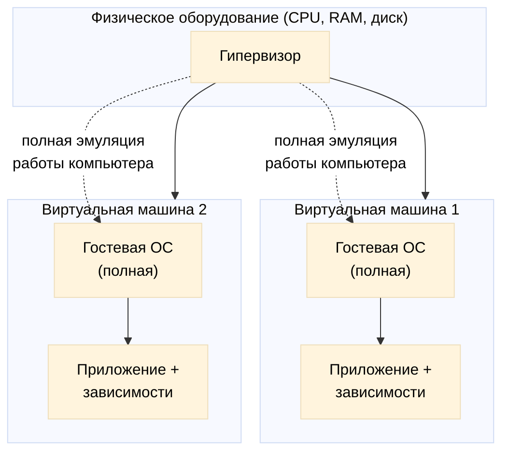
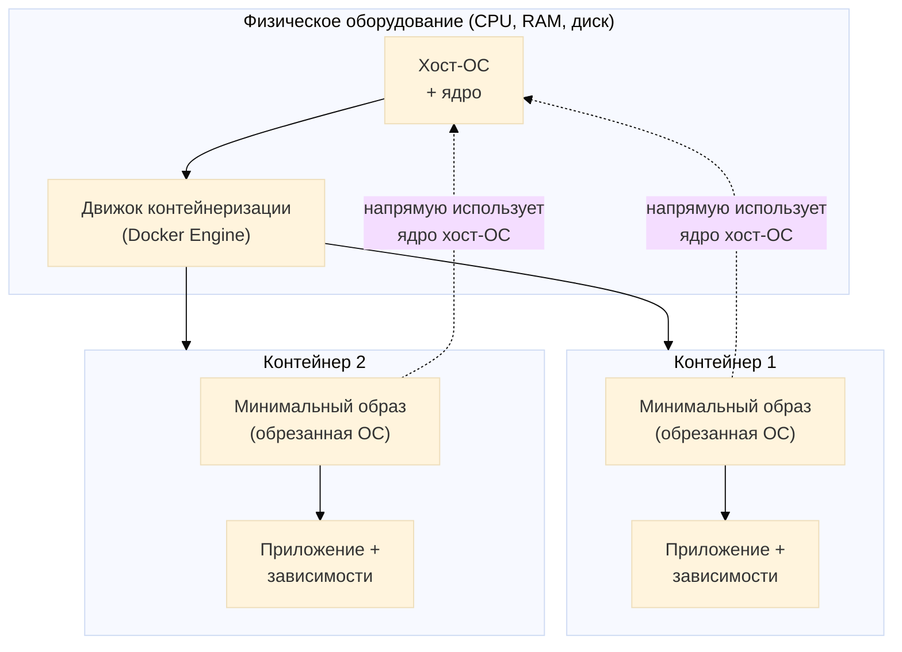
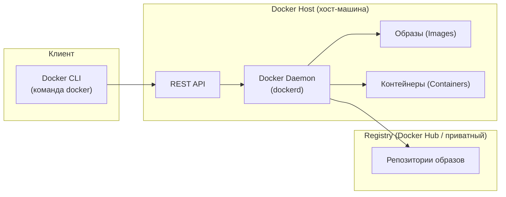
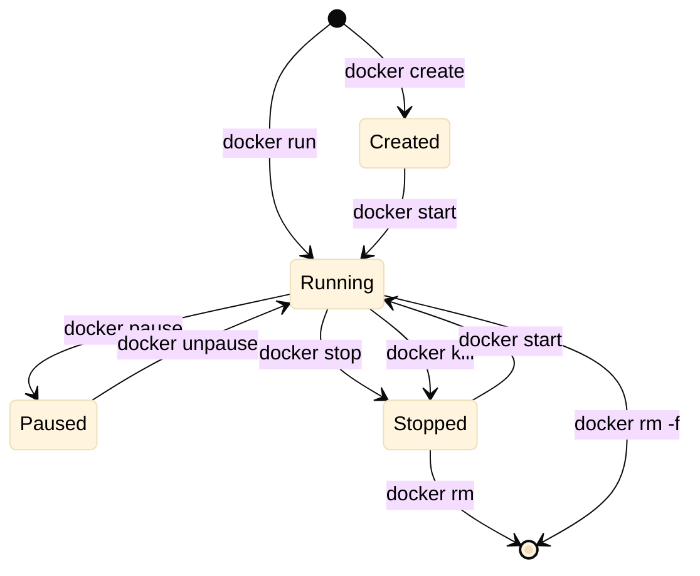

# Docker за час

Евсеев Иван Александрович 151319

Code and Cold Club 2026

---

## Оглавление

!toc

---

## Проблема

**Невозможность унификации рабочей системы и отсутствие автоматизации её развёртывания.**

- У каждого разработчика — своё окружение: версии ПО, библиотеки, настройки.
- «У меня работает» — не аргумент, если у коллеги не работает.
- Ручная настройка системы отнимает время и воспроизводится с ошибками.
- Нет единого способа быстро развернуть одинаковую среду на любой машине.

**Вопрос:** как решить проблему унификации и автоматизации развёртывания?


---

## Методы виртуализации

Решение есть — **виртуализация**.

На данный момент основных инструмента два:

1. **Виртуальные машины (VM)** — работа через гипервизор.
2. **Контейнеры (Docker)** — работа через движок, использующий ядро ОС напрямую.

---

## Виртуальные машины

**Как работает:** гипервизор полностью эмулирует работу компьютера с точки зрения ОС, на него ставится полноценная гостевая ОС.


---

**Плюсы:**
  - Полная изоляция — своя ОС, своё ядро.
  - Хорошо подходит для тестирования и обучения.
  - Высокий уровень безопасности.

**Минусы:**
  - Требует много ресурсов (CPU, RAM, диск).
  - Плохо масштабируется — каждая VM «весит» как отдельный компьютер.
  - Долгий запуск.

---
## Контейнеры

**Как работает:** движок напрямую использует ядро хост-ОС без эмуляции, а операционные системы обрезаются до минимально работоспособного состояния.


---

**Плюсы:**
  - Лёгкость и скорость запуска.
  - Отличное масштабирование — одной командой можно поднять множество работоспособных систем с относительно низкими затратами.
  - Единый образ — одинаковая среда везде.

**Минусы:**
  - Вопросы безопасности: работа с ядром напрямую.
  - Для Docker требуются root-права (или настройка rootless-режима).

---
## А что же такое Docker?

**Docker** — платформа контейнеризации, которая позволяет упаковать приложение со всеми зависимостями в единый образ и запускать его в изолированном контейнере на любой машине с Docker.

**Ключевые понятия:**
  - Образ (image) — шаблон с приложением и зависимостями.
  - Контейнер (container) — запущенный экземпляр образа.
  - Dockerfile — инструкция сборки образа.
  - Docker Compose — описание многоконтейнерного приложения.

---



---
## Жизненный цикл контейнера

**Основные команды и этапы:**
- docker pull — загрузить образ из реестра.
- docker run — создать и запустить контейнер.
- docker ps — список запущенных контейнеров.
- docker stop / docker start — остановить / запустить.
- docker rm — удалить контейнер.
- docker rmi — удалить образ.

---



---

## Какие есть настройки?
```bash
docker run -d --name myapp -p 8080:80 -v /data:/app/data -e ENV=prod myimage:latest
```

- `-d` — запуск в фоне (detached).  
- `--name` — имя контейнера.
- `-p 8080:80` — проброс порта хост:контейнер.
- `-v /data:/app/data` — монтирование тома.
- `-e ENV=prod` — переменная окружения.
- `myimage:latest` — образ и тег.

---
## Масштабирование

**Docker позволяет масштабировать приложение:**
  - Docker Compose: docker compose up --scale web=3 — поднять несколько экземпляров сервиса.
  - Swarm / Kubernetes — оркестрация контейнеров для продакшена.
  - Один образ — множество контейнеров с низкими затратами ресурсов.

---
## Синтаксис
<!-- layout:two-column -->
**Dockerfile** — инструкция сборки образа:
```dockerfile
FROM python:3.12-slim
WORKDIR /app
COPY requirements.txt .
RUN pip install -r requirements.txt
COPY . .
CMD ["python", "app.py"]
```

**Docker Compose** — описание сервисов:
```yaml
services:
  web:
    build: .
    ports:
      - "8080:80"
```
---
# Задания

---
##  L0

- Запустить готовый контейнер: docker run hello-world.
- Посмотреть список контейнеров и образов.

---

## L1

- Написать простой Dockerfile для своего приложения.
- Собрать образ: docker build -t myapp ..
- Запустить контейнер и проверить работу.

---
## L2* 

- Написать docker-compose.yml для приложения с базой данных.
- Запустить: docker compose up.
- Настроить переменные окружения и тома.

---

## Обратная связь

!poll[Выразите своё мнение, идеи и пожелания в форме обратной связи](https://forms.yandex.com/cloud/6aec89e04a052d3a210da82e) 

---

# Источники

- https://www.docker.com/resources/what-container
- https://docs.docker.com/compose/gettingstarted

